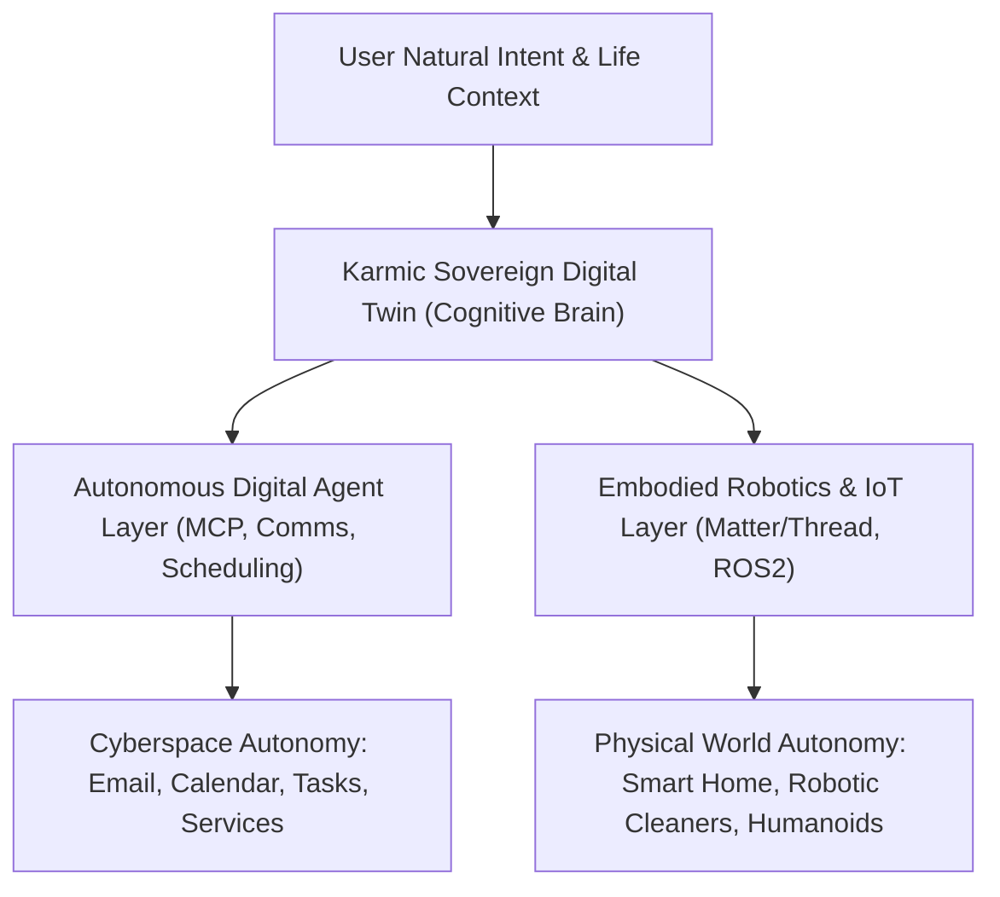
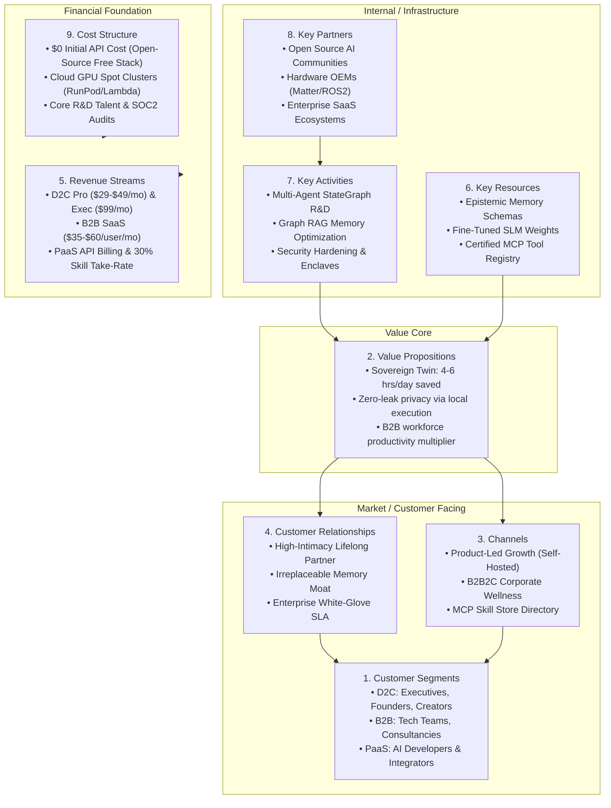
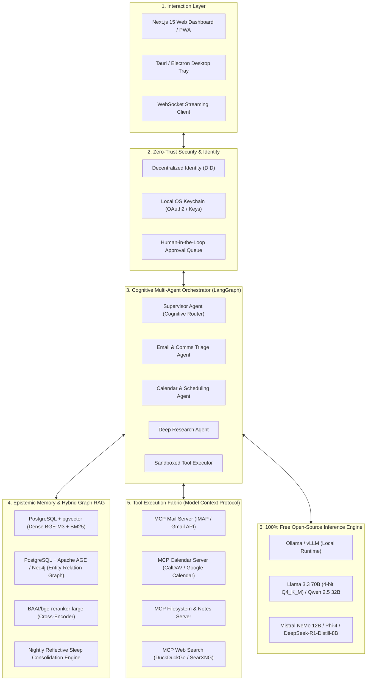
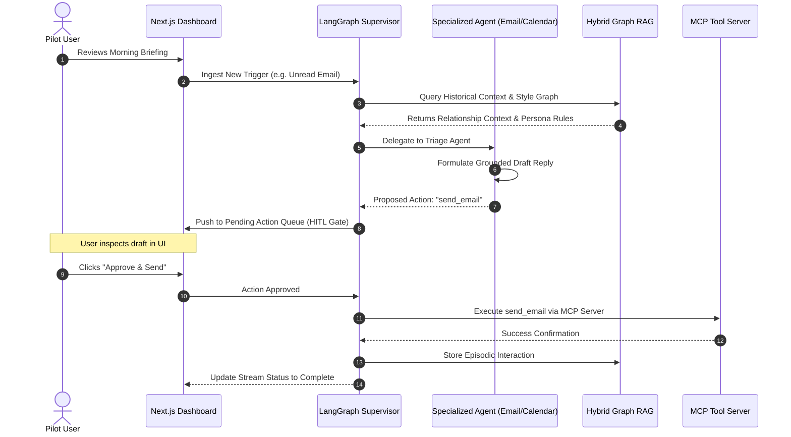
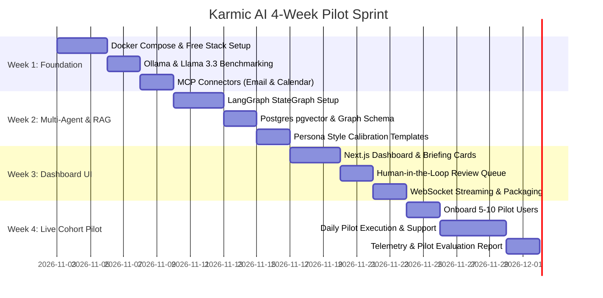

# Karmic AI Platform: Design & Architecture Specification
**Sovereign Personal Digital Twin & Autonomous Agentic OS**  
*Document Version: 1.0.0 | Release: Phase 1 Prototype & Strategic Master Architecture*

---

## 1. Executive Summary & Vision

Modern knowledge workers and executives spend 40% to 60% of their daily bandwidth operating as manual dispatchers: reading inboxes, resolving scheduling conflicts, transcribing meeting action items, and following up on scattered dependencies.

**Karmic AI Platform** is an agentic, sovereign personal digital twin designed to systematically bridge **Cognitive Agency**, **Autonomous Cyberspace Execution**, and **Physical Embodied Automation**.



---

## 2. Strategic Value Proposition & Market Differentiation

### 2.1 Value Drivers Across Horizons

| Horizon | Core Value Proposition | Primary Impact Metric |
| :--- | :--- | :--- |
| **D2C Personal Twin** | Sovereign proxy acting in the user's authentic voice; eliminates administrative churn with zero-leak local privacy. | **4 to 6 productive hours returned daily** |
| **B2B SaaS Suite** | Dedicated agentic Chief of Staff for every team lead; eliminates scheduling friction and unifies cross-silo context. | **3x - 5x team velocity multiplier** |
| **B2B PaaS Platform** | Extensible developer substrate providing standardized Model Context Protocol (MCP) tool execution and hybrid Graph RAG. | **70% compression in enterprise agent build time** |
| **Physical Robotics Bridge** | Hardware-agnostic middleware translating cognitive schedules into spatial domestic tasks. | **2+ domestic maintenance hours saved daily** |

---

## 3. The 9-Box Business Model Canvas



---

## 4. Problem Statements & Granular Feature Use Cases

### 4.1 Phase 1 Focus: Productivity & Efficiency Agentic Suite (5-10 User Pilot)

1. **Adaptive Morning Context Briefing**:
   - Runs autonomously at 07:00 AM local time.
   - Summarizes unread messages, highlights 3 primary objectives, flags scheduling conflicts, and recommends focus blocks.
2. **Persona-Emulated Email Triage & Drafting**:
   - Classifies inbound emails (Urgent, Transactional, Informational, Low Priority).
   - Generates high-fidelity draft replies matching the user's historical tone, vocabulary, and sign-offs.
   - Pushes drafts to the **Human-in-the-Loop Review Queue** for single-click approval.
3. **Autonomous Calendar Negotiation**:
   - Intercepts meeting requests, applies user focus rules (e.g., "No morning calls before 11:00 AM"), proposes optimal slots, and manages invites.
4. **Intelligent Task Decomposition**:
   - Takes natural language projects (e.g., "Prepare board update") and breaks them down into sequenced sub-tasks with estimated durations and dependencies.
5. **Private Document Graph RAG**:
   - Enables semantic and multi-hop queries across local files, past emails, and project notes with exact source citations.
6. **Multi-Agent Swarm Orchestration**:
   - Supervisor Agent delegates to specialized sub-agents: Triage Agent, Calendar Agent, Research Agent, and Tool Executor.

### 4.2 Subsequent Expansion Horizons

- **Phase 2 (Health & Longevity)**: Continuous wearable telemetry ingestion (Apple Health, Oura, Whoop), circadian-aware calendar rescheduling, proactive bio-routine guardrails.
- **Phase 3 (Financial & Consumer Ops)**: Zombie subscription cancellation, automated bill dispute mediation, relationship anniversary management.
- **Phase 4 (B2B SaaS & PaaS)**: Shared team knowledge graphs, enterprise Slack/Teams agent swarms, public MCP Developer Marketplace.
- **Phase 5 (Embodied Robotics)**: Matter/Thread IoT bridge, ROS2 cleaning and humanoid bimanual coordination.

---

## 5. Industry Best Practices & Leader Success Stories

Karmic AI synthesizes proven architectural patterns from top industry breakthroughs:

- **Anthropic Model Context Protocol (MCP)**: Standardized open protocol separating the cognitive model from tool servers. Used as Karmic's universal tool execution interface.
- **MemGPT / Letta (Hierarchical OS Memory)**: Tiered memory management (working context buffer, episodic vector memory, archival graph memory).
- **Rewind AI / Limitless (Ambient Privacy-Preserving Capture)**: Background indexing of user context locally without third-party cloud data leakage.
- **LangGraph (Deterministic State Machines)**: Replaces fragile unconstrained agent loops with deterministic state machines featuring explicit Human-in-the-Loop checkpoints.
- **Microsoft Research (GraphRAG)**: Integrates structural entity-relationship extraction with community summarization for multi-hop reasoning.

---

## 6. End-to-End System Architecture



---

## 7. 100% Free & Open-Source Technology Stack

| Component | Open-Source Technology | License | Implementation Role |
| :--- | :--- | :--- | :--- |
| **Local LLM Runtime** | **Ollama** / **vLLM** / **llama.cpp** | MIT / Apache 2.0 | High-performance local inference on consumer GPUs (NVIDIA RTX 3060/4090 or Apple Silicon M-series). Zero API subscription cost. |
| **Primary Cognitive LLM** | **Llama 3.3 70B (Q4_K_M)** or **Qwen 2.5 32B** | Llama 3.3 Community / Apache 2.0 | Complex reasoning, persona style-emulated drafting, project task decomposition. |
| **Fast Router SLM** | **Mistral NeMo 12B** / **Phi-4** | Apache 2.0 / MIT | Sub-second intent classification, tool dispatching, and email urgency categorization. |
| **Embeddings** | **BAAI/bge-m3** | Apache 2.0 | Multilingual dense + sparse lexical vectors with 8192 token context. |
| **Reranker** | **BAAI/bge-reranker-large** | Apache 2.0 | Cross-encoder reranking scoring relevance before context injection. |
| **Vector DB** | **PostgreSQL + pgvector** | PostgreSQL License | Integrated relational metadata, conversation sessions, and HNSW vector indexing. |
| **Knowledge Graph** | **PostgreSQL + Apache AGE** (or **Neo4j CE**) | Apache 2.0 | Graph storage for entities, relationships, preferences, and claims. |
| **Agent Framework** | **LangGraph** (Python) | MIT | Stateful multi-agent state machines with persistence and approval checkpoints. |
| **Backend Gateway** | **FastAPI** + **Pydantic v2** + **Uvicorn** | MIT | Asynchronous REST and real-time WebSocket token streaming gateway. |
| **Cache & Task Queue** | **Redis** + **Python Asyncio** / **Celery** | BSD 3-Clause | Session state caching, token rate limiting, and background embedding jobs. |
| **Frontend UI** | **Next.js 15** + **Tailwind CSS** + **shadcn/ui** | MIT | Modern, reactive dark-mode dashboard with approval cards and agent trace logs. |
| **Desktop Client** | **Tauri v2** (Rust + Webview) or **Electron** | MIT | Ultra-lightweight system tray daemon (< 60MB RAM footprint). |
| **Orchestration** | **Docker** & **Docker Compose** | Apache 2.0 | Single-command automated deployment (`docker-compose up -d`). |

---

## 8. Multi-Agent Orchestration & Human-in-the-Loop Workflow



---

## 9. 5-10 User Pilot Implementation Plan (4-Week Sprint)



### Pilot Evaluation Metrics:
- **Time Liberated**: Target $\ge 2.5$ hours of manual administrative effort saved per user per day.
- **Draft Acceptance Rate**: Target $\ge 90\%$ of drafted emails accepted as-is or with minor edits ($<10$ words).
- **Safety Compliance**: $0$ unapproved external mutations; $100\%$ adherence to HITL gates.
- **End-to-End Latency**: Sub-second initial response; draft generation under $8$ seconds on local inference.
- **Net Promoter Score (NPS)**: Target $\ge 70$ among pilot participants.

---

## 10. Quickstart Execution Guide (Zero-Cost Local Setup)

To spin up the entire Karmic AI Platform locally with zero external API costs:

```bash
# 1. Clone & Enter Repository
git clone <repo-url> "Karmic AI Platform"
cd "Karmic AI Platform"

# 2. Launch Free Open-Source Infrastructure Stack
docker-compose up -d

# 3. Pull Open-Source Foundation Models into Local Ollama
docker exec -it karmic-ollama ollama pull llama3.3:70b-instruct-q4_K_M
docker exec -it karmic-ollama ollama pull mistral-nemo:12b
docker exec -it karmic-ollama ollama pull bge-m3

# 4. Access the Dashboard
# Web Interface: http://localhost:3000
# Backend API Docs: http://localhost:8000/docs
```

