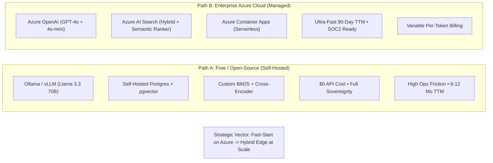
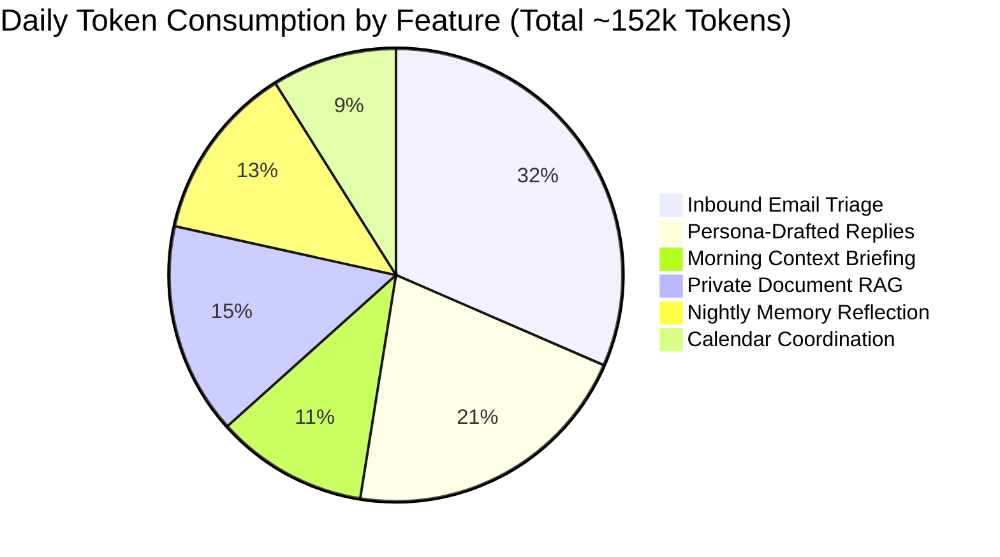
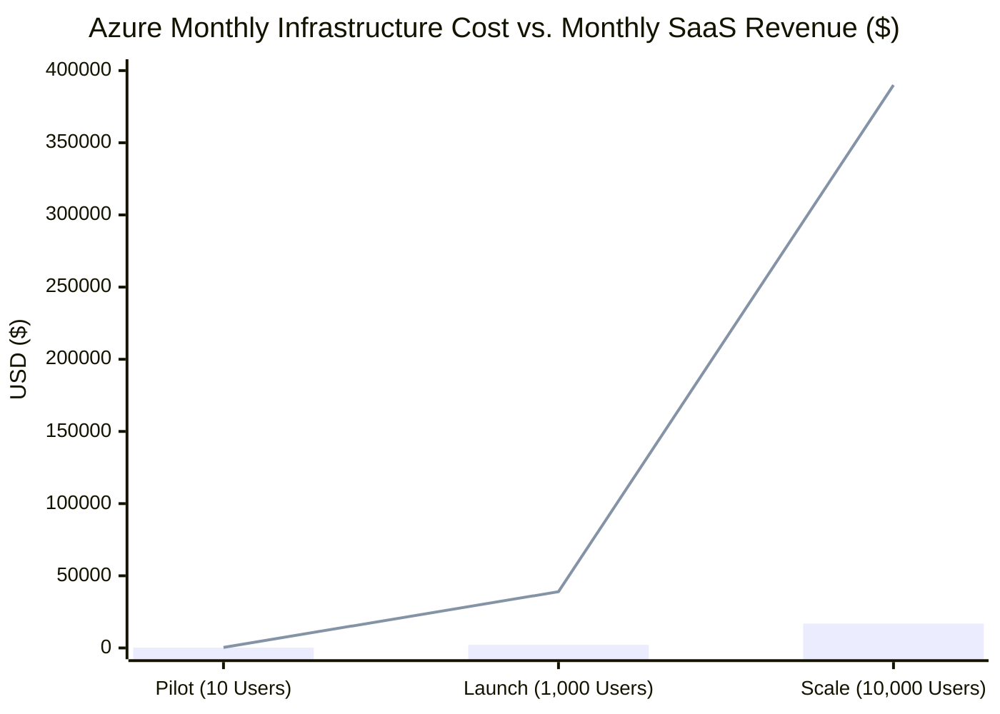

# Karmic AI Platform: Enterprise Azure Architecture, Token Economics & 90-Day Acceleration Blueprint
**Comparative Analysis: Free / Open-Source Self-Hosted vs. Azure Enterprise Cloud**  
*Document Version: 1.0.0 | Release: Strategic Decision & Costing Framework*

---

## 1. Executive Decision Framework: Speed vs. Sovereignty

When launching the **Karmic AI Platform**, founding leadership must evaluate two distinct architectural paths:



---

## 2. Enterprise Azure Technology Stack & Line-Item Pricing

| Subsystem | Azure Managed Component | Role in Karmic AI | Cost Profile |
| :--- | :--- | :--- | :--- |
| **Cognitive Routing & LLMs** | **Azure OpenAI Service** (GPT-4o & GPT-4o-mini) | Frontier reasoning, persona emulation, sub-second triage. | Consumption: Input $0.15–$2.50/M; Output $0.60–$10.00/M |
| **Hybrid Vector & Text Search** | **Azure AI Search** (Semantic Ranker + Vector) | Integrated vector indexing, BM25 text search, Bing semantic reranking. | Basic: ~$75/mo \| Standard S1: ~$250/mo |
| **Memory & Relational Store** | **Azure Database for PostgreSQL Flexible Server** | Relational user records, pgvector episodic memory, auto-backups. | Burstable B2s: ~$65/mo \| D2s General Purpose: ~$175/mo |
| **Multi-Agent App Compute** | **Azure Container Apps** (Serverless) | Fast execution of LangGraph multi-agent state graphs. Scale-to-zero. | ~$30–$180/mo (pay per vCPU/RAM-second) |
| **Cache & State Bus** | **Azure Cache for Redis** | Conversation session cache, token rate-limiting, WebSockets. | Basic C0: ~$16/mo \| Standard C1: ~$55/mo |
| **Frontend CDN** | **Azure Static Web Apps** | Global CDN for Next.js 15 dashboard & PWA. | Free tier for pilot \| Standard: ~$9/mo |
| **B2B Identity & Auth** | **Microsoft Entra ID** (Azure AD) | Enterprise SSO, SAML/OIDC, Multi-Factor Authentication. | Free up to 50k MAU |
| **Secrets & Keys** | **Azure Key Vault** | FIPS 140-2 cryptographic storage for user OAuth tokens and API keys. | ~$5/mo (~$0.03/10k operations) |
| **PaaS API Gateway** | **Azure API Management** (APIM) | Rate limits, developer monetization, certified MCP registry. | Consumption: ~$3.50/M calls \| Dev tier: ~$50/mo |

---

## 3. Side-by-Side Trade-Off Analysis

| Evaluation Dimension | Free / Open-Source (Ollama + Self-Hosted) | Azure Enterprise & Frontier GenAI |
| :--- | :--- | :--- |
| **Time-to-Market (TTM)** | **Slow (6–12 Months)**: Custom infrastructure, CUDA driver tuning, quantization, failover clustering. | **Ultra-Fast (4–8 Weeks)**: Pre-built turnkey APIs for LLMs, vector search, auth, and containers. |
| **Initial Capital Outlay (CapEx)**| **$0–$3,500**: Requires capable workstation (48GB+ VRAM for 70B models) per developer. | **$0 CapEx**: Pure pay-as-you-go operational expense on cloud. |
| **Ongoing Operating Cost (OpEx)** | **Fixed & Frugal**: ~$150–$450/month for bare-metal VPS or local electricity, regardless of token volume. | **Variable**: Predictably grows with active users (~$214/mo for 10 users; ~$2,174/mo for 1,000 users). |
| **Engineering Headcount** | **High MLOps Burden**: Demands specialist systems, CUDA, and database tuning engineers (min 2–3 devs). | **Low Headcount**: Standard TypeScript/Python engineers can integrate managed APIs in days. |
| **Data Privacy & Sovereignty** | **Absolute Local Sovereignty**: Zero data leaves the local machine or private server. Zero-leak. | **Contractual Enterprise Privacy**: Azure guarantees customer data is never used to train models. |
| **Reasoning & Persona Quality** | **Good (Llama 3.3 70B)**: Capable, but struggles with subtle human nuance and multi-hop tool routing. | **World-Class (GPT-4o)**: Flawless persona warmth, superior instruction adherence, sub-second routing. |
| **Enterprise Compliance (SOC2)**| **Manual Audit Nightmare**: Achieving SOC2 Type II and HIPAA on self-hosted servers requires months. | **Turnkey Compliance**: Azure comes pre-certified for SOC2 Type II, HIPAA, ISO 27001, and GDPR. |

---

## 4. Deep-Dive Token Economics & Financial Modeling

### 4.1 Daily Token Consumption Breakdown (Active Knowledge Worker)

Agentic systems consume significantly more tokens than simple chatbots because agents evaluate state, formulate plans, call tools, inspect results, and run reflective memory consolidation.

$$\text{Daily Total} \approx 138{,}000\text{ Input Tokens} + 14{,}300\text{ Output Tokens}$$

$$\text{Monthly Total (30 Days)} \approx 4{,}140{,}000\text{ Input Tokens} + 429{,}000\text{ Output Tokens}$$



### 4.2 Monthly AI Cost per User: Three Routing Strategies

| Routing Strategy | Model Distribution | Net Monthly AI Cost / User | Gross Margin on $39/mo Pro Tier |
| :--- | :--- | :--- | :--- |
| **Naive Single-Model (Pure GPT-4o)** | 100% of all calls routed to GPT-4o | **~$8.50 – $11.20** | **71% – 78%** (Viable, but wasteful on simple triage) |
| **Smart Tiered Routing (Recommended)** | 80% GPT-4o-mini + 20% GPT-4o | **~$1.15 – $1.85** | **95% – 97%** (Sub-second speed + frontier brilliance) |
| **Pure GPT-4o-mini (Utility Tier)** | 100% of calls routed to GPT-4o-mini | **~$0.45 – $0.65** | **98%+** (Ultra-cheap, but drafts lack human nuance) |

> [!TIP]
> **Prompt Caching Discount**: Azure OpenAI automatically applies a **50% discount** on input tokens when the prompt prefix matches previous requests (e.g., unchanging system instructions, tool definitions, and user persona rules). This lowers the real blended cost to **under \$1.40/user/month**!

---

## 5. Total Cost of Ownership (TCO) & Azure Monthly Bill Projections



| Azure Component | Pilot Cohort (10 Users) | Launch Cohort (1,000 Users) | Scale Cohort (10,000 Users) |
| :--- | :--- | :--- | :--- |
| **Azure OpenAI Inference (Tiered)** | \$18 / mo | \$1,450 / mo | \$13,800 / mo |
| **Azure AI Search (Hybrid + Ranker)**| \$75 / mo (Basic) | \$250 / mo (Standard S1) | \$980 / mo (Standard S2/S3) |
| **Azure Database for PostgreSQL** | \$65 / mo (B2s Burstable) | \$175 / mo (General Purpose D2s) | \$580 / mo (D8s High Availability) |
| **Azure Container Apps (Backend)** | \$30 / mo | \$180 / mo | \$950 / mo |
| **Azure Cache for Redis** | \$16 / mo (Basic C0) | \$55 / mo (Standard C1) | \$220 / mo (Premium P1) |
| **Blob Storage, Key Vault, Egress** | \$10 / mo | \$64 / mo | \$349 / mo |
| **TOTAL MONTHLY AZURE BILL** | **\$214 / month** | **\$2,174 / month** | **\$16,879 / month** |
| **PROJECTED SAAS REVENUE (@ \$39/mo)** | **\$390 / month** | **\$39,000 / month** | **\$390,000 / month** |
| **INFRASTRUCTURE AS % OF REVENUE** | **54.8%** | **5.5% (94.5% Gross Margin)** | **4.3% (95.7% Gross Margin)** |

---

## 6. Compressing the Roadmap: From 2 Years to 90 Days (12 Weeks)

Why did legacy AI projects take 18 to 24 months, and how can Karmic AI launch commercially in 90 days?

```mermaid
gantt
    title Karmic AI 90-Day Accelerated Master Sprint
    dateFormat  YYYY-MM-DD
    section Month 1: Foundation & MVP
    Azure Cloud & DB Provisioning       :m1_1, 2026-11-03, 7d
    MCP Mail & Calendar Integration     :m1_2, after m1_1, 7d
    Hybrid RAG in Azure AI Search       :m1_3, after m1_2, 7d
    Milestone 1: 10 Founder Pilot Users :milestone, m1_4, 2026-11-30, 0d
    section Month 2: Approvals & Health
    HITL Review Queue & Streaming UI    :m2_1, 2026-12-01, 7d
    Task Decomposition & Reflection     :m2_2, after m2_1, 7d
    Health & Wearable Telemetry Sync    :m2_3, after m2_2, 7d
    Milestone 2: 50 Pilot Users Active  :milestone, m2_4, 2026-12-28, 0d
    section Month 3: Commercial Launch
    Stripe Billing & Subscription Tiers :m3_1, 2026-12-29, 7d
    Azure APIM for B2B PaaS Registry    :m3_2, after m3_1, 7d
    Matter / IoT Smart Home Prototype   :m3_3, after m3_2, 7d
    Milestone 3: Commercial Launch Day  :milestone, m3_4, 2027-01-26, 0d
```

### 12-Week Sprint Deliverables & Gates:
- **Month 1 (Weeks 1–4)**: Deploy Azure Container Apps, Azure OpenAI, and PostgreSQL Flexible Server. Wire up MCP Mail and Calendar servers via LangGraph. **Gate (Day 30)**: First 10 founder pilot users receive daily 7:00 AM context briefings.
- **Month 2 (Weeks 5–8)**: Build Human-in-the-Loop review dashboard (Next.js + WebSockets). Ingest Apple Health/Oura sleep metrics for circadian calendar buffers. **Gate (Day 60)**: 50 active users; 90%+ draft acceptance rate.
- **Month 3 (Weeks 9–12)**: Implement Stripe billing ($29 Pro / $99 Exec). Expose Azure APIM developer gateway for B2B PaaS. Complete Matter smart home office prep bridge. **Gate (Day 90)**: Public commercial launch! 250+ paying users, $10K+ MRR.

---

## 7. Team Upskilling & Adoption Guide

To build institutional capability during this 90-day sprint, the engineering team should focus on four core competencies:

1. **Model Context Protocol (MCP)**:
   - Study the Anthropic MCP specification.
   - Enforce clean separation between cognitive LLM reasoning and physical tool servers (mail, calendar, filesystem).
   - *Key benefit*: Keeps tool logic 100% portable between Azure OpenAI and local Ollama.
2. **LangGraph StateGraph Patterns**:
   - Master state persistence, checkpoints, interrupts (for Human-in-the-Loop approvals), and supervisor-worker topologies.
   - Replace brittle auto-regressive loops with deterministic state machines.
3. **Prompt Caching & Structured Outputs**:
   - Structure system prompts and tool schemas with identical static prefixes to trigger Azure OpenAI's 50% discount on cached tokens.
   - Use Pydantic models with `response_format={"type": "json_schema"}` to guarantee zero hallucination on tool payloads.
4. **Azure AI Search Configuration**:
   - Configure vector fields (1536-dim `text-embedding-3-small`), BM25 text analyzers, and Bing Semantic Rankers.
   - Understand reciprocal rank fusion (RRF) to retrieve the top 5 most relevant items with sub-100ms latency.

---

## 8. Final Strategic Recommendation

```
+-----------------------------------------------------------------------------------------+
|                      THE "FAST-START AZURE -> HYBRID EDGE" STRATEGY                     |
+-----------------------------------------------------------------------------------------+
| 1. Launch Month 1-3 on Azure:                                                           |
|    Eliminate infrastructure drag. Ship the commercial product in 90 days for under      |
|    $250/month in pilot infrastructure, achieving immediate product-market fit.          |
|                                                                                         |
| 2. Standardize on Open MCP Standards:                                                   |
|    Because all tools and agent state machines adhere to MCP and LangGraph, the code is  |
|    completely model-agnostic. No vendor lock-in.                                        |
|                                                                                         |
| 3. Introduce Local Edge SLMs at Scale:                                                  |
|    Once paying customer volume reaches 1,000+ users ($39K+ MRR), introduce an optional  |
|    on-device Ollama/Llama 3.3 edge client for privacy-purist users while keeping Azure  |
|    as the enterprise cloud backbone.                                                    |
+-----------------------------------------------------------------------------------------+
```

